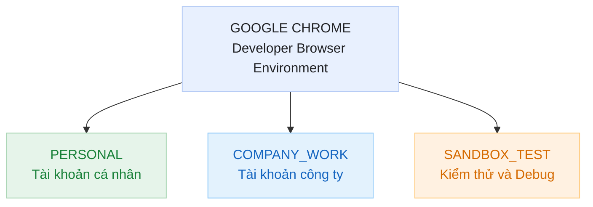

# (Bài tập tổng hợp) Ngày Đầu Thực Tập Dev Tại Công Ty Công Nghệ
## Phần A – Thiết lập Profile và Bookmark chuẩn Dev
### 1. Phân tích vấn đề khi sử dụng chung một Chrome Profile
Khi sử dụng chung một Chrome Profile cho cả GitHub cá nhân và GitHub công ty, trình duyệt có thể xảy ra xung đột phiên đăng nhập (Session Conflict).

**Nguyên nhân:**
- Mỗi Chrome Profile có một User Data Directory riêng để lưu trữ dữ liệu trình duyệt.
- Các tab thuộc cùng một Profile có thể chia sẻ Cookies của cùng một website.
- Khi đăng nhập hai tài khoản GitHub khác nhau trong cùng Profile, Cookie xác thực có thể bị cập nhật hoặc thay thế.
- Điều này có thể khiến tài khoản đang đăng nhập bị chuyển đổi, gây nhầm lẫn khi thao tác với Repository cá nhân và Repository công ty.

**Hậu quả:**
- Nhầm lẫn giữa tài khoản GitHub cá nhân và công ty.
- Push code nhầm Repository.
- Phải đăng nhập và đăng xuất nhiều lần.
- Khó quản lý lịch sử và tài liệu công việc.

**Giải pháp:** Sử dụng Dedicated Browser Profiles để phân tách môi trường làm việc. Mỗi Profile có Cookies, History, Bookmarks và Extensions độc lập.
### 2. Thiết kế mô hình 3 Profile chuẩn Developer
Đề xuất mô hình gồm 3 Profile:
|Profile|Tên đặt|Mục đích sử dụng|
|---|---|---|
|1|Personal|Sử dụng GitHub cá nhân, email cá nhân, mạng xã hội và các hoạt động riêng tư.|
|2|Company_Work|Sử dụng GitHub công ty, email công việc, tài liệu dự án, hệ thống quản lý công việc và môi trường phát triển.|
|3|Sandbox_Test|Kiểm thử website, API, đăng nhập tài khoản thử nghiệm và debug ứng dụng.|

**Sơ đồ kiến trúc:**

**Kết luận:** Mô hình 3 Profile giúp tách biệt dữ liệu, hạn chế xung đột phiên đăng nhập và nâng cao hiệu quả quản lý môi trường làm việc của Developer.
### 3. Thiết kế cấu trúc Bookmark
Đề xuất 3 thư mục chính, mỗi thư mục gồm 2 website:
```text
BOOKMARK_BAR
│
├── 01_DEVELOPMENT
│   ├── GitHub Company
│   └── GitHub Documentation
│
├── 02_DEBUGGING
│   ├── test.internal-tool.com
│   └── Chrome DevTools Documentation
│
└── 03_API_TOOLS
    ├── JSON Formatter
    └── Postman
```
**Giải thích:**
|Thư mục|Mục đích|
|---|---|
|01_DEVELOPMENT|Lưu trữ nền tảng quản lý mã nguồn và tài liệu lập trình.|
|02_DEBUGGING|Truy cập website cần kiểm thử và tài liệu hỗ trợ debug.|
|03_API_TOOLS|Lưu công cụ định dạng JSON và kiểm thử API.|
### 4. Xử lý tình huống đồng nghiệp mượn máy tính trong 5 phút
**Lựa chọn:** Guest Profile (Chế độ khách).

**Lý do:**
- Guest Profile tạo môi trường duyệt web tạm thời, tách biệt với Profile chính.
- Người mượn máy không sử dụng trực tiếp Cookies, History và Bookmarks của Profile cá nhân.
- Dữ liệu duyệt web trong phiên Guest sẽ bị xóa khi đóng toàn bộ cửa sổ Guest.

**Quy trình:**
1. Nhấn biểu tượng Profile trên Chrome.
2. Chọn Guest (Khách).
3. Bàn giao máy tính cho đồng nghiệp.
4. Sau khi sử dụng, yêu cầu đóng toàn bộ cửa sổ Guest.

**Vì sao không chọn Incognito?**

Incognito vẫn hoạt động bên trong Profile hiện tại và không phải môi trường khách độc lập. Guest Profile phù hợp hơn khi bàn giao máy cho người khác sử dụng tạm thời.
## Phần B – Chọn đúng Extension hỗ trợ
### 1. Chọn Extension phù hợp với API JSON thô
**Lựa chọn:** JSON Formatter – thuộc nhóm Dev Suite.

**Chức năng:**

JSON Formatter giúp định dạng dữ liệu JSON thô thành cấu trúc dễ đọc, hỗ trợ:
- Hiển thị dữ liệu theo dạng phân cấp.
- Thụt lề (Indentation) rõ ràng.
- Nhận biết các trường dữ liệu và giá trị.
- Thu gọn hoặc mở rộng các đối tượng JSON.

**Ví dụ:**

JSON thô ban đầu:
```JSON
{"id":101,"name":"Developer","active":true,"skills":["HTML","CSS","JavaScript"]}
```
Sau khi định dạng:
```JSON
{
  "id": 101,
  "name": "Developer",
  "active": true,
  "skills": [
    "HTML",
    "CSS",
    "JavaScript"
  ]
}
```
**Tại sao không chọn hai nhóm còn lại?**
|Nhóm Extension|Chức năng|Lý do không phù hợp|
|---|---|---|
|Dev Suite|Hỗ trợ lập trình, debug, định dạng dữ liệu và kiểm thử.|Phù hợp nhất với yêu cầu xử lý JSON.|
|Productivity Suite|Hỗ trợ quản lý công việc, ghi chú và tăng năng suất.|Không tập trung vào xử lý JSON.|
|Security Suite|Hỗ trợ bảo mật, kiểm tra quyền riêng tư và cảnh báo nguy cơ.|Không giải quyết trực tiếp vấn đề định dạng JSON.|

**Kết luận:** Dev Suite là nhóm Extension phù hợp nhất với nhiệm vụ của Developer.
### 2. Thiết lập quyền Site Access
**Lựa chọn:** On click.

**Giải thích:**
- On click: Extension chỉ được phép truy cập website khi người dùng chủ động nhấn vào tiện ích.
- On all sites: Extension có thể truy cập các website thuộc phạm vi quyền được cấp.

**Lý do chọn On click:**
1. Tuân thủ nguyên tắc Least Privilege (Quyền tối thiểu).
2. Hạn chế Extension truy cập dữ liệu trên các website không cần thiết.
3. Giảm nguy cơ lộ thông tin đăng nhập và dữ liệu cá nhân.
4. Người dùng chủ động kiểm soát thời điểm Extension hoạt động.

**Kết luận:** Ưu tiên On click thay vì On all sites để tăng cường bảo mật trình duyệt.
## Phần C – Phân tích luồng HTTP Request
### 1. Bốn giai đoạn xử lý HTTP Request Flow
Khi người dùng nhập `test.internal-tool.com` vào thanh địa chỉ và nhấn Enter, trình duyệt thực hiện các giai đoạn sau:

**Giai đoạn 1:** URL Parsing và DNS Resolution
- Trình duyệt phân tích địa chỉ URL.
- Xác định giao thức HTTP/HTTPS, hostname và đường dẫn.
- DNS phân giải tên miền thành địa chỉ IP của máy chủ.

**Giai đoạn 2:** Establish Connection
- Trình duyệt thiết lập kết nối TCP với máy chủ.
- Nếu sử dụng HTTPS, thực hiện TLS Handshake để thiết lập kết nối mã hóa.
- Kiểm tra chứng chỉ bảo mật của website.

**Giai đoạn 3:** HTTP Request và Response
- Trình duyệt gửi HTTP Request đến máy chủ.
- Máy chủ xử lý yêu cầu.
- Máy chủ trả về HTTP Response gồm Status Code, Headers và Response Body.

**Giai đoạn 4:** Browser Rendering
- Trình duyệt phân tích HTML để tạo DOM.
- Phân tích CSS để tạo CSSOM.
- Kết hợp DOM và CSSOM để xây dựng Render Tree.
- Thực thi JavaScript và hiển thị nội dung lên màn hình.

**Sơ đồ HTTP Request Flow:**
```text
Nhập URL và nhấn Enter
          |
          v
1. URL Parsing
   DNS Resolution
          |
          v
2. Establish Connection
   TCP / TLS
          |
          v
3. HTTP Request
   HTTP Response
          |
          v
4. Browser Rendering
   DOM / CSSOM / Render Tree
          |
          v
    Website hiển thị
```
### 2. So sánh HTTP 404 và HTTP 500
|Tiêu chí	| 404 Not Found |	500 Internal Server Error|
|---|---|---|
|Ý nghĩa	| Không tìm thấy tài nguyên được yêu cầu. |	Máy chủ gặp lỗi nội bộ khi xử lý yêu cầu.|
|Lỗi thường nằm ở đâu? |	URL, Route hoặc tài nguyên không tồn tại. |	Backend, cơ sở dữ liệu hoặc cấu hình máy chủ.|
|Hướng debug |	Kiểm tra URL, Endpoint, HTTP Method và Route. |	Kiểm tra Server Logs, Backend Logs và quá trình xử lý dữ liệu.|

**Phân tích:**
- **404 Not Found:** Trình duyệt gửi yêu cầu đến một đường dẫn không tồn tại hoặc máy chủ không tìm thấy tài nguyên tương ứng.
- **500 Internal Server Error:** Máy chủ gặp sự cố khi xử lý yêu cầu, có thể do lỗi chương trình, cơ sở dữ liệu hoặc cấu hình hệ thống.
### 3. Chọn Tab DevTools để xem HTTP Status Code
**Lựa chọn:** Network Tab.

**Lý do:** Network Tab ghi nhận các HTTP Request và HTTP Response giữa trình duyệt và máy chủ, bao gồm:
- Request URL.
- Request Method.
- Status Code.
- Response Headers.
- Request Payload.
- Response Body.
- Timing.

**Tại sao không chọn các Tab còn lại?**
|Tab	| Chức năng chính |	Lý do không chọn|
|---|---|---|
|Elements |	Kiểm tra và chỉnh sửa DOM, CSS.	| Không chuyên dùng để theo dõi HTTP Status Code.|
|Console	| Xem JavaScript Logs và Errors.	| Không cung cấp giao diện quản lý đầy đủ các HTTP Request.|
|Network |	Theo dõi Request và Response. |	Đây là Tab phù hợp nhất.|
|Application |	Quản lý Cookies, Local Storage, Session Storage và Cache. |	Không phải công cụ chính để kiểm tra HTTP Status Code.|
## Phần D – Chẩn đoán Cache và Cookies
### 1. Dev sửa CSS nhưng F5 vẫn hiển thị giao diện cũ
**Nguyên nhân:** Browser Cache.

Trình duyệt lưu trữ các tài nguyên tĩnh như CSS, JavaScript và hình ảnh để tăng tốc độ tải trang.

Khi Developer cập nhật CSS trên máy chủ, trình duyệt có thể tiếp tục sử dụng bản CSS cũ trong Cache thay vì tải phiên bản mới.

**Cách khắc phục:**

*Phương pháp 1: Hard Reload*
1. Mở website `test.internal-tool.com`.
2. Nhấn `Ctrl + Shift + R`.
3. Trình duyệt yêu cầu tải lại trang và các tài nguyên thay vì sử dụng Cache thông thường.

*Phương pháp 2: Disable Cache*
1. Nhấn F12 để mở DevTools.
2. Chọn Tab Network.
3. Tích chọn `Disable cache`.
4. Giữ DevTools mở.
5. Nhấn F5 để tải lại trang.

**Kết luận:** Hard Reload hoặc Disable cache giúp kiểm tra phiên bản CSS mới mà không cần chỉnh sửa file gốc của dự án.
### 2. Cookie session_id không có thuộc tính HttpOnly
**Rủi ro bảo mật:**

Nếu Cookie `session_id` không được thiết lập thuộc tính `HttpOnly`, JavaScript phía trình duyệt có thể đọc Cookie này thông qua `document.cookie`, tùy thuộc các thuộc tính Cookie khác.

Khi website tồn tại lỗ hổng Cross-Site Scripting (XSS), mã JavaScript độc hại có thể lợi dụng khả năng đọc Cookie để lấy cắp thông tin phiên đăng nhập.

**Tên loại tấn công:**
- Cross-Site Scripting (XSS).
- Session Hijacking (chiếm quyền phiên đăng nhập).

**Giải pháp:**
- Thiết lập thuộc tính `HttpOnly` cho Cookie phiên đăng nhập.
- Bật `Secure` để Cookie chỉ được gửi qua HTTPS.
- Thiết lập `SameSite` phù hợp.
- Kiểm tra và khắc phục các lỗ hổng XSS.
### 3. Chỉ đăng xuất nhưng vẫn giữ Cache
**Lựa chọn:** Xóa Cookie của website cần đăng xuất.

**Các bước thực hiện:**
1. Mở website cần đăng xuất.
2. Nhấn F12 để mở DevTools.
3. Chọn Tab Application.
4. Mở mục Storage.
5. Chọn Cookies.
6. Chọn domain tương ứng.
7. Tìm Cookie `session_id`.
8. Xóa Cookie này.

**Kết quả:**
- Phiên đăng nhập có thể bị kết thúc khi Cookie xác thực bị xóa.
- Cache hình ảnh, CSS và JavaScript vẫn được giữ lại.
- Không cần sử dụng Clear All Browsing Data.
## Phần E – Debug bằng Inspect Element và Network Tab
### 1. Kiểm tra và sửa màu nút Đăng nhập bằng Inspect Element
**Mục tiêu:** Thử nghiệm thay đổi màu nút trực tiếp trên trình duyệt để xác định mã màu chính xác, không chỉnh sửa file CSS gốc.

**Các bước thực hiện:**
1. Mở website `test.internal-tool.com`.
2. Nhấn F12 để mở DevTools.
3. Chọn Tab Elements.
4. Nhấn biểu tượng Select Element (Ctrl + Shift + C).
5. Nhấp vào nút Đăng nhập trên giao diện.
6. Tìm thuộc tính CSS `background-color` trong bảng Styles.
7. Nhấp vào giá trị màu hiện tại.
8. Thay đổi mã màu HEX hoặc RGB theo thiết kế.
9. Quan sát giao diện sau khi thay đổi.

Ví dụ:
```CSS
background-color: #2563EB;
color: #FFFFFF;
```
**Kết quả:** Nút Đăng nhập được hiển thị với màu xanh dương và chữ trắng để kiểm chứng thiết kế.
### 2. Quy trình 4 bước Debugging khi API Request hiển thị màu đỏ trong Network
**Bước 1:** Identify – Xác định lỗi
- Mở DevTools bằng F12.
- Chọn Tab Network.
- Tìm Request API có dòng màu đỏ.
- Ghi nhận Request URL, Method và Status Code.

**Bước 2:** Inspect – Kiểm tra chi tiết

Chọn Request bị lỗi và kiểm tra:
- Headers: Kiểm tra Request URL, Method và Response Headers.
- Payload: Kiểm tra dữ liệu gửi lên máy chủ.
- Response: Kiểm tra nội dung phản hồi.
- Timing: Kiểm tra thời gian xử lý yêu cầu.

**Bước 3:** Analyze – Phân tích nguyên nhân

Dựa vào thông tin thu thập được để xác định nguyên nhân:
- 400: Bad Request – Yêu cầu không hợp lệ.
- 401: Unauthorized – Chưa xác thực.
- 403: Forbidden – Không có quyền truy cập.
- 404: Not Found – Không tìm thấy tài nguyên.
- 500: Internal Server Error – Lỗi nội bộ máy chủ.
- 503: Service Unavailable – Dịch vụ tạm thời không khả dụng.

Ngoài ra, kiểm tra Console để tìm JavaScript Errors và các thông báo liên quan.

**Bước 4:** Verify – Kiểm chứng kết quả
- Thử gửi lại Request trong điều kiện được phép.
- Kiểm tra Response sau khi xử lý.
- Xác nhận Status Code và dữ liệu trả về.
- Ghi lại nguyên nhân và báo cáo cho Developer phụ trách nếu lỗi thuộc Backend.

**Sơ đồ quy trình**
```text
1. IDENTIFY
   Xác định Request lỗi
          |
          v
2. INSPECT
   Kiểm tra Headers, Payload, Response
          |
          v
3. ANALYZE
   Phân tích Status Code và nguyên nhân
          |
          v
4. VERIFY
   Kiểm chứng và báo cáo kết quả
```
### 3. Lọc API Request và tải dữ liệu mới nhất trong Network
Cần thực hiện đúng 2 thao tác:

**Thao tác 1:** Lọc API Request
- Mở DevTools.
- Chọn Network.
- Chọn bộ lọc Fetch/XHR.

Tác dụng: Chỉ hiển thị các yêu cầu Fetch và XMLHttpRequest, giúp tập trung vào những lời gọi API thay vì các tài nguyên như hình ảnh, CSS và JavaScript.

**Thao tác 2:** Bật Disable Cache
- Tích chọn `Disable cache` trong Network.
- Giữ DevTools mở trong quá trình kiểm thử.
- Tải lại trang để kiểm tra dữ liệu mới nhất từ máy chủ.

**Kết quả:** Network tập trung hiển thị các API Request và hạn chế sử dụng HTTP Cache của trình duyệt khi DevTools đang mở.
